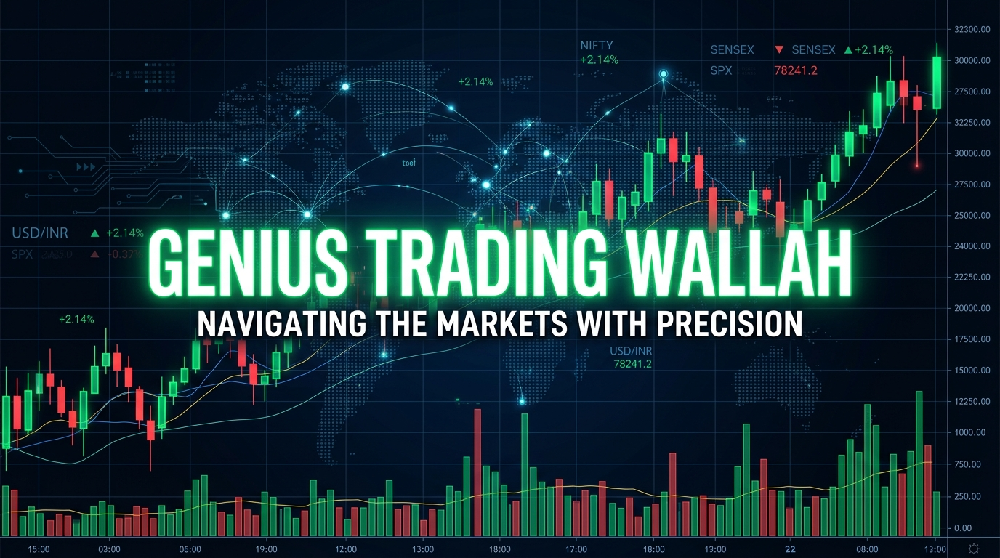

<h1 align="center">
  
</h1>

  

  
  
  
  

---

## 🏛️ Executive Summary & Mission
**Full-Time Trader 📊 | Pure Price Action ⚡ | Smart Money Concepts 🧠 | Quant & Cloud Builder ☁️**

I am on an unyielding mission to bridge the gap between institutional market mechanics and retail traders across India. Trading is not gambling — it is probability, liquidity engineering, and ruthless risk control.

- 🎯 **Target:** Consistent Systematic Alpha with strict 1:3+ Risk-to-Reward.
- 📘 **Founder of [Genius Trading Wallah](https://github.com/Satyenderparihar/Genius-Trading-Wallah):** A comprehensive 100% Free Open-Source 15-Module Trading Masterclass (880+ lessons).
- 💬 **DM for Mentorship & Inquiries:** Ready to elevate your market execution? Reach out on Telegram / WhatsApp!
- 🇮🇳 Dedicated to elevating financial literacy and wealth independence in India.

---

## 🧠 Smart Money Concepts (SMC) Masterclass

<b>🔥 Click to expand: What is a Fair Value Gap (FVG)?</b>

 

A **Fair Value Gap (FVG)** is one of the most powerful concepts in Smart Money trading. It occurs when a large injection of institutional volume causes the price to move rapidly, leaving an imbalance between the wicks of the surrounding candles.

### How to Spot an FVG (3-Candle Formation):
1. **Candle 1:** The origin wick.
2. **Candle 2:** Massive institutional displacement candle.
3. **Candle 3:** The third candle's wick does **NOT overlap** with Candle 1's wick.

*(The unfilled void between Candle 1's high and Candle 3's low is the Fair Value Gap!)*

### How to Trade it 🎯
The market is drawn to FVGs like a magnet. When the price retraces back into this gap, it rebalances the inefficiency before continuing its original trend. **Look for precision entries inside the FVG zone to ride the institutional wave!**

<b>💎 Click to expand: What is an Order Block (OB) & Liquidity Sweep?</b>

 

- **Order Block (OB):** The final opposite-direction candle before an aggressive displacement that breaks market structure (BOS/CHOCH). It represents the exact price zone where institutions accumulated large orders.
- **Liquidity Sweep:** When price aggressively punctures previous Equal Highs (BSL) or Equal Lows (SSL) to trigger retail stop losses before violently reversing in the true direction.

---

## 🏆 Featured Repositories

  <table border="0">
    <tr>
      <td width="50%" align="center">
        
      </td>
      <td width="50%" align="center">
        
      </td>
    </tr>
  </table>

---

## 🛠️ Domain Mastery & Technical Stack

### 📈 Financial Markets & Analytics

  
  
  
  
  

### 💻 Quantitative & Automation Engineering

  
    
  
  
  

---

## 📊 Analytics & Activity

  
  

  

 

  <picture>
    <source media="(prefers-color-scheme: dark)" srcset="https://raw.githubusercontent.com/Satyenderparihar/Satyenderparihar/output/dist/github-snake-dark.svg" />
    <source media="(prefers-color-scheme: light)" srcset="https://raw.githubusercontent.com/Satyenderparihar/Satyenderparihar/output/dist/github-snake.svg" />
    
  </picture>

---

## 🏆 GitHub Trophies

  

---

## 📬 Connect with Genius Trading Wallah

   &nbsp;
   &nbsp;
   &nbsp;
   &nbsp;
  

  

---

  © 2026 <b>Genius Trading Wallah</b>. Designed for Precision, Discipline & Consistency.

